How a chatmail relay works
==========================

Chatmail relay dependency diagram
---------------------------------

   This diagram shows relay components and dependencies/communication paths.

Accepting and delivering mail
-----------------------------

   This diagram shows all the paths a message can take.

Operational details of a chatmail relay
----------------------------------------

Mailbox directory layout
~~~~~~~~~~~~~~~~~~~~~~~~

Fresh chatmail addresses have a mailbox directory that contains:

-  a ``password`` file with the salted password required for
   authenticating whether a login may use the address to send/receive
   messages. If you modify the password file manually, you effectively
   block the user.

-  ``enforceE2EEincoming`` is a default-created file with each address.
   If present the file indicates that this chatmail address rejects
   incoming cleartext messages. If absent the address accepts incoming
   cleartext messages.

-  ``dovecot*``, ``cur``, ``new`` and ``tmp`` represent IMAP/mailbox
   state. If the address is only used by one device, the Maildir
   directories will typically be empty unless the user of that address
   hasn’t been online for a while.

App version information (experimental)
~~~~~~~~~~~~~~~~~~~~~~~~~~~~~~~~~~~~~~

A chatmail relay ships the
:relayfile:`appversions.json <chatmaild/src/chatmaild/defaults/appversions.json>`
file of the ``chatmaild`` package
and serves its content under the IMAP METADATA key
``/shared/vendor/deltachat/appversions``.
Chat apps installed outside of app stores read this key
to learn about updates and where to download them.
The mechanism is experimental and may change.

On a cmrelay host the file is part of the installed release.
There is no automatic refresh:
version information changes only with ``cmrelay upgrade FILE``.

.. note::

   Note that as of August 2026, only Delta Chat Android Google Play version
   is beginning to support discovering app versions from relays.
   Consumers of relay-provided app version information,
   currently only the Delta Chat Android app,
   need to verify themselves that downloaded app files are valid.

.. _active-ports:

Active ports
~~~~~~~~~~~~

.. list-table::
   :header-rows: 1
   :widths: 20 12 68

   * - Service
     - Port
     - Protocol
   * - Postfix_
     - 25
     - SMTP
   * - Postfix_
     - 587
     - SUBMISSION
   * - Postfix_
     - 465
     - SUBMISSIONS
   * - Dovecot_
     - 143
     - IMAP
   * - Dovecot_
     - 993
     - IMAPS
   * - Nginx_
     - 443
     - HTTPS, which multiplexes HTTPS, IMAP and SMTP using ALPN
       to redirect connections to ports 8443, 465 or 993
   * - Nginx_
     - 8443
     - HTTPS-ALT
   * - Nginx_
     - 80
     - HTTP, which passes certificate challenges on to
       `acmetool <https://hlandau.github.io/acmetool/>`_
   * - `chatmail-turn <https://github.com/chatmail/chatmail-turn>`_
     - 3478 UDP
     - STUN/TURN; further UDP ports are opened temporarily when users request them,
       from an unrestricted range

chatmail-core based apps will, however, discover all ports and
configurations automatically by reading the `autoconfig XML
file <https://www.ietf.org/archive/id/draft-bucksch-autoconfig-00.html>`_
from the chatmail relay server.

Email domain authentication (DKIM)
~~~~~~~~~~~~~~~~~~~~~~~~~~~~~~~~~~

Chatmail relays enforce :rfc:`DKIM <6376>` to authenticate incoming emails
(except for :ref:`IP-only relays <iponly>`).
Incoming emails must have a valid DKIM signature with
Signing Domain Identifier (SDID, ``d=`` parameter in the DKIM-Signature
header) equal to the ``From:`` header domain. This property is checked
by filtermail when it verifies the signatures. This
corresponds to strict :rfc:`DMARC <7489>` alignment (``adkim=s``).
If there is no valid DKIM signature on the incoming email, the
sender receives a “5.7.1 No valid DKIM signature found” error.

Note that chatmail relays

- do **not** rely on DMARC and do not consult the sender policy published in DMARC records;

- do **not** rely on legacy authentication mechanisms such as
  :rfc:`iprev <8601#section-2.7.3>` and :rfc:`SPF <7208>`.
  Any IP address is accepted if the DKIM signature was valid.

Outgoing emails must be sent over authenticated connection with envelope
``MAIL FROM`` (return path) corresponding to the login.
This is ensured by Postfix which maps login username to ``MAIL FROM`` with
`smtpd_sender_login_maps <https://www.postfix.org/postconf.5.html#smtpd_sender_login_maps>`_
and rejects incorrectly authenticated emails with
`reject_sender_login_mismatch <https://www.postfix.org/postconf.5.html#reject_sender_login_mismatch>`_ policy.
``From:`` header must correspond to envelope ``MAIL FROM``, this is
ensured by ``filtermail`` proxy.

TLS requirements
~~~~~~~~~~~~~~~~

Filtermail delivers mail to other relays and email servers
only over TLS with a valid certificate.
So a relay needs a valid certificate to receive mail from other chatmail relays.

You can test it by resolving ``MX`` records of your relay domain and
then connecting to MX relays (e.g ``mx.example.org``) with
``openssl s_client -connect mx.example.org:25 -verify_hostname mx.example.org -verify_return_error -starttls smtp``
from the host that has open port 25 to verify that certificate is valid.

When providing a TLS certificate to your chatmail relay server, make
sure to provide the full certificate chain and not just the last
certificate.

If you use an external certificate manager (e.g. Traefik or certbot),
set ``tls_external_cert_and_key`` in ``chatmail.ini``
to provide the certificate and key paths.
See :ref:`external-tls` for details.

A debugging help if you are running an Exim server
and don’t see incoming connections from a chatmail relay server in the logs:
make sure the ``smtp_no_mail`` log
item is enabled in the config with ``log_selector = +smtp_no_mail``. By
default Exim does not log sessions that are closed before sending the
``MAIL`` command. This happens if certificate is not recognized as valid
by Postfix, so you might think that connection is not established while
actually it is a problem with your TLS certificate.

If emails don’t arrive at your chatmail relay server, the
problem is likely that your relay does not have a valid TLS certificate.

Note that connections to relays with underscore-prefixed test domains
(e.g. ``_chat.example.org``) use ``encrypt`` tls security level,
because such domains cannot obtain valid Let's Encrypt certificates
and run with self-signed certificates.

.. _dovecot: https://dovecot.org
.. _postfix: https://www.postfix.org
.. _nginx: https://nginx.org
